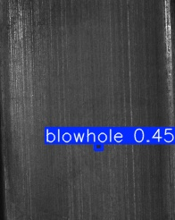
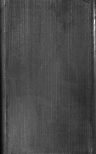
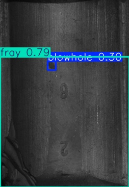

# 磁瓦表面缺陷检测系统

面向电机磁瓦产线的表面缺陷自动检测系统：单图 / 批量检测、五类缺陷定位、OK/NG 自动判级、结果存档与历史复查。**纯 CPU 可运行**，单机即可部署。

| | |
|---|---|
| 模型 | YOLOv8n 迁移学习微调（自训练权重，非预置基线模型） |
| 数据规模 | 训练 936 张 / 验证 202 张 / 测试 202 张，五类表面缺陷 |
| 工件级判定准确率 | **99.01%**（200/202），漏放 **0** 张 |
| 硬件 | 纯 CPU，无 GPU 依赖 |

---

## 它解决什么问题

磁瓦（电机用永磁铁氧体）表面缺陷目前主要靠人工目检：长时间盯产线容易疲劳、判定标准不一致、漏检率不可控。

本系统把这一步做成"拍照 → 自动判级"：输入一张工件图或一整个文件夹，输出 **OK / NG** 判定，以及缺陷的位置、类别和置信度，并留存检测记录供复查。

判定规则刻意做得保守：**只要检出超过阈值的缺陷框就判 NG，绝不把"检测失败"当成 OK** —— 在质检场景里，漏放（有缺陷判成 OK）的代价远高于误杀。

---

## 效果

| 缺陷件 → NG | 正常件 → OK |
|---|---|
|  |  |
|  | 系统流程图见 `docs/images/flow.png` |

---

## 技术方案

```
图片 / 文件夹
      │
      ▼
┌─────────────────┐
│ YOLOv8n 推理     │  conf >= 0.25
│ 五类缺陷检测     │──────────────┐
└─────────────────┘              │
      │                          ▼
      │                    ┌────────────┐
      └───────────────────▶│ OK / NG 判定│
                           └────────────┘
                                  │
                    ┌─────────────┴─────────────┐
                    ▼                           ▼
              results/ 存档图            history.json 历史记录
```

- **模型**：YOLOv8n，在官方预训练权重基础上迁移学习，50 epochs、`imgsz=640`、`batch=16`、`device=cpu`、`patience=15`、`seed=42`
- **系统**：Tkinter 桌面端，零额外依赖
- **存储**：结果图按时间戳命名写入 `results/`，检测记录以 JSON 追加写入 `history.json`
- **配置**：所有路径与阈值集中在 `config.py`，支持环境变量覆盖，不写死绝对路径

---

## 检测结果（验证集 202 张）

| 指标 | 数值 |
|---|---|
| Precision | 0.884 |
| Recall | 0.807 |
| F1 | 0.844 |
| mAP@0.5 | 0.767 |
| mAP@0.5:0.95 | 0.491 |
| **工件级判定准确率** | **99.01%（200/202）** |
| 漏放（有缺陷判 OK） | **0 / 59** |
| 误杀（无缺陷判 NG） | 2 / 143 |

### 分类别召回率

| 类别 | 中文 | Recall |
|---|---|---|
| blowhole | 气孔 | 0.976 |
| break | 崩边 | **0.438** |
| crack | 裂纹 | 1.000 |
| fray | 毛边 | 0.857 |
| uneven | 不平整 | 0.765 |

> **短板分析**：崩边召回率 0.438 明显低于其他四类。这类缺陷区域小、与背景对比弱，在 640 输入分辨率下容易漏检。后续改进方向：提高输入分辨率、针对小目标做数据增强、补充崩边样本。完整评价说明见 [`docs/metrics.md`](docs/metrics.md)。

---

## 快速开始

```bash
git clone https://github.com/xxh666umr/magnetic-tile-defect-detection.git
cd magnetic-tile-defect-detection

pip install -r requirements.txt

# 权重不入库，需单独下载后放到 weights/best.pt（见 weights/README.md）
python main.py
```

Windows 下也可以直接双击 `启动系统.bat`。

---

## 目录结构

```
magnetic-tile-defect-detection/
├── main.py              # 主程序：界面 + 检测 + 历史记录
├── config.py            # 集中配置：路径、阈值、类别名
├── train.py             # 训练脚本
├── val.py               # 评价脚本：输出指标并写 val_summary.json
├── flow_chart.py        # 系统流程图生成脚本
├── test_pipeline.py     # 冒烟测试
├── samples/             # 示例图片（六类，可直接用于演示）
├── docs/
│   ├── metrics.md       # 完整评价说明
│   └── images/          # 效果图与流程图
├── weights/             # 模型权重（不入库，见 README）
├── requirements.txt
└── LICENSE
```

不入库的目录：`datasets/`、`weights/`、`runs/`、`results/`、`history.json`，均在 `.gitignore` 中。

---

## 实现要点

1. **失败不等于 OK**。模型缺失、图片打不开、检测异常都会明确提示并标记为"读取失败"，不会混进 OK 统计——这是质检系统最基本的正确性要求。
2. **批量检测的容错**。单张图片失败不中断整批，失败项单独记录并在列表中标出，进度条按实际处理数推进。
3. **历史记录持久化**。保存结果时按时间戳命名，避免覆盖旧结果；记录写入 JSON，程序关闭后重新打开仍可复查。
4. **路径与阈值集中管理**。早期版本把绝对路径写在三个脚本里，换机器就崩；重构后统一由 `config.py` 提供，并支持环境变量覆盖。
5. **中文路径兼容**。ultralytics 在处理含中文的输出目录时会异常，训练产物目录因此统一使用英文命名。

---

## 已知问题与改进方向

- **崩边召回偏低（0.438）**：小目标漏检，见上文分析。
- **仅桌面端**：目前是 Tkinter 单机程序，没有对外接口。下一步计划拆出 `FastAPI` 服务层，把推理与界面解耦，再补 Docker 部署和并发压测。
- **未做系统性延迟基准**：只验证了功能正确性，吞吐和 P95 延迟尚未测量。
- **阈值固定 0.25**：未按类别分别调阈值，而各类别的最优阈值并不相同。

---

## 数据与权重说明

- **数据集**不随仓库分发，需自行准备 YOLO 格式的磁瓦缺陷数据（`data.yaml` + `images/` + `labels/`）。
- **模型权重**不随仓库分发（体积原因），从 Releases 下载后放入 `weights/best.pt`。

---

## 开发说明

代码在 AI 辅助下完成初稿，本人在此基础上完成数据整理、训练与调参、逐项功能修改与测试、界面交互验证，并能逐行解释实现细节。

---

## License

[MIT](LICENSE)
